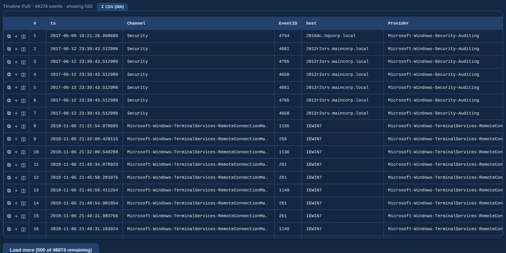

<div align="center">

# 🐕 WinHound

**Forensic Windows EVTX analyzer — ingest event logs, query with SQL, hunt with Sigma.**

Feed it `.evtx` files (even straight from a `.zip`), open the browser, and investigate: one
timeline in UTC, full‑text and field search, Sigma and LOL detections, process trees, logons,
persistence, PowerShell, network, IOCs, triage marks and a one‑click case report.
**Runs 100% locally and offline.**


</div>

---

<p align="center">
  
</p>

<p align="center">
  <b>📚 Documentation: <a href="https://g92mz.github.io/winhound/">g92mz.github.io/winhound</a></b><br>
  <sub>every tab explained, with screenshots</sub>
</p>

## 🚀 Quickstart

Python **3.11+** with `pip`, on Windows, Linux or macOS.

```bash
pip install -r requirements.txt
python run.py                 # then open http://127.0.0.1:8000 (or http://<this-pc-ip>:8000)
```

`python run.py` checks for updates on every start (`python update.py` does it on demand), keeping
your cases and GeoIP data. Options, loading and cases in
[Getting started](https://g92mz.github.io/winhound/getting-started/).

## ✨ What it does

- 🪟 **EVTX ingest** — any channel, Sysmon-aware, from files, folders or archives, with live progress.
- 🔎 **Search** — one query language shared with Longanizer (`field=value` equal, `field:value` contains, `AND` / `OR` / `NOT`), facets, and click a cell to filter by it.
- 🛡️ **Sigma and LOL** — your rules and LOLBAS / LOLDrivers / LOLRMM / HijackLibs / LOTTunnels packs, lookalike binaries and the case's ATT&CK coverage.
- 🌲 **Hunting** — process trees, logons (Kerberos, NTLM, RDP), persistence, PowerShell script blocks, network.
- 🧷 **IOCs** — indicators discovered in the data, and a sweep for the ones you paste; GeoIP / ASN for public IPs.
- 📌 **Triage and report** — mark events, then export a self-contained HTML case report.
- 🤖 **AI and MCP** — ask about the case through your AI provider, a local model or an MCP client, read-only.

## 🧪 Samples

562 public attack EVTX ship in `samples/evtx-attack-samples.zip`
([EVTX-ATTACK-SAMPLES](https://github.com/sbousseaden/EVTX-ATTACK-SAMPLES) by @sbousseaden).
Point the loader straight at the `.zip`, or unzip it and load the folder.

## 📝 Principles

- **Local and offline** — no cloud and no outbound calls, except the optional GeoIP download and the AI endpoint you configure.
- **Your data stays yours** in `casos/` and `geoip_data/`, git-ignored and kept across updates.
- **Bring your own rules** — WinHound ships no Sigma or LOL rules.
- **No login** — the web UI has no authentication; keep it on a trusted network or use `--host 127.0.0.1`.

## 📜 License

Licensed under the **Apache License 2.0** — see [`LICENSE`](LICENSE) and `NOTICE`.

© 2026 Gregorio Moreno (**gmzpt**)
