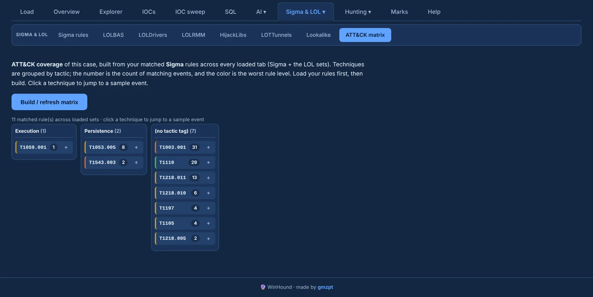

# ATT&CK matrix

The **ATT&CK matrix** turns the case's matched rules into coverage. It collects the `attack.*` tags
of the rules that hit, from **every loaded set** (Sigma plus each LOL tab), and lays the techniques
out by tactic.

{ .shot }

- **Columns are tactics**; techniques sit under their tactic.
- Each technique is **coloured by the highest rule level** that produced it, and the number is the
  count of matching events.
- **Click a technique** to jump to a sample event; its **+** sends a sample of that technique to
  [review](../investigate/marks-report.md) with a 10-event frozen context.

The matrix reflects your ruleset's tagging: techniques only appear for matched rules that declare
`attack.*` tags. Load and run your rules first, then **Build / refresh matrix**.
