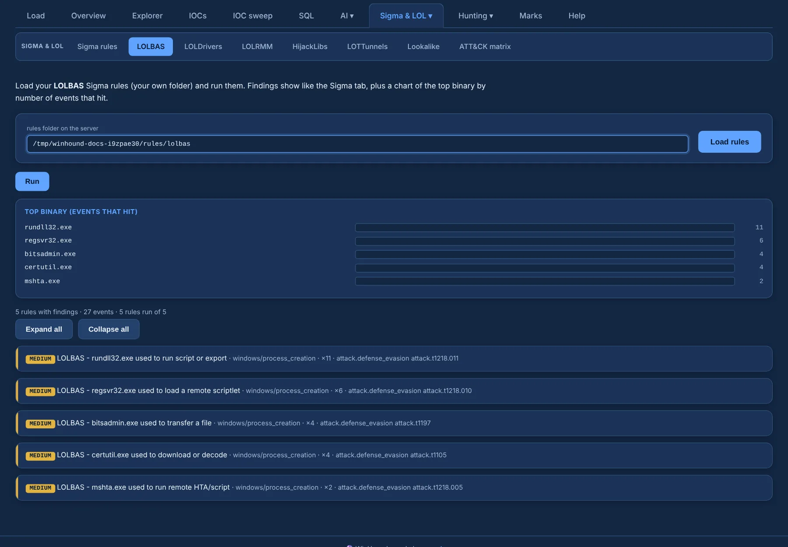

# LOL packs

One tab per living-off-the-land family, under **Sigma & LOL ▾**:

| Tab | Chart of the top… |
|---|---|
| **LOLBAS** | binaries |
| **LOLDrivers** | drivers |
| **LOLRMM** | remote-management tools |
| **HijackLibs** | DLLs |
| **LOTTunnels** | tunnelling tools |

{ .shot }

Each tab loads **its own rules folder** (you supply the Sigma rules — WinHound pulls no external
datasets), shows the findings exactly like the [Sigma](sigma.md) tab — what matched, rule YAML,
⧉ copy, view structured raw and the mark buttons — and adds a **chart of the top indicator** by
number of events that hit.

Every loaded set also feeds the [ATT&CK matrix](attack.md).
