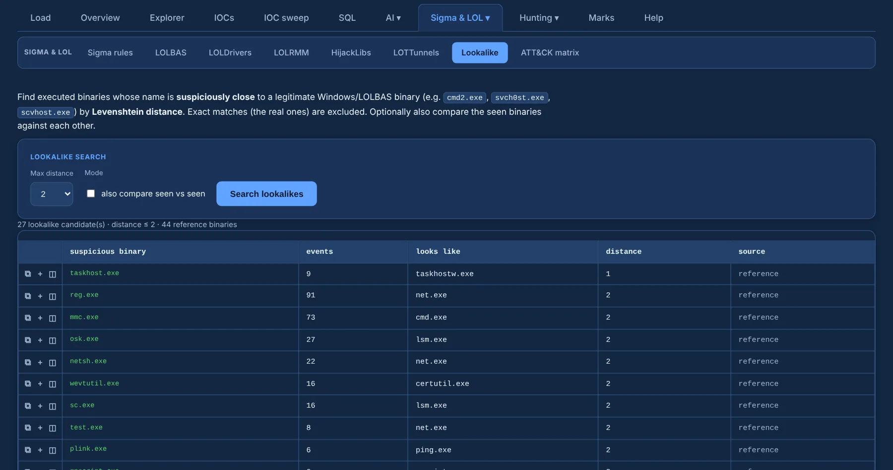

# Lookalike binaries

**Lookalike** finds executed binaries whose name is within a small **edit (Levenshtein) distance**
of a legitimate Windows or LOLBAS binary — `cmd2.exe`, `svch0st.exe`, `scvhost.exe`. Exact matches
(the real ones) are left out.

{ .shot }

- Binaries come from **all sources**: Sysmon `Image` and Security 4688 `NewProcessName`.
- Pick the **max distance**; optionally also compare the binaries seen in the case with each other.
- Results are grouped by binary, with their events, the binary they look like and the distance.
  Click a row to pivot to the Explorer; the mark button sends a **sample event** of that binary
  to review.

!!! tip
    Distance **1** is the high-signal setting. Distance 2 can surface coincidences
    (`osk.exe` vs `lsm.exe`), so always confirm in the Explorer.
