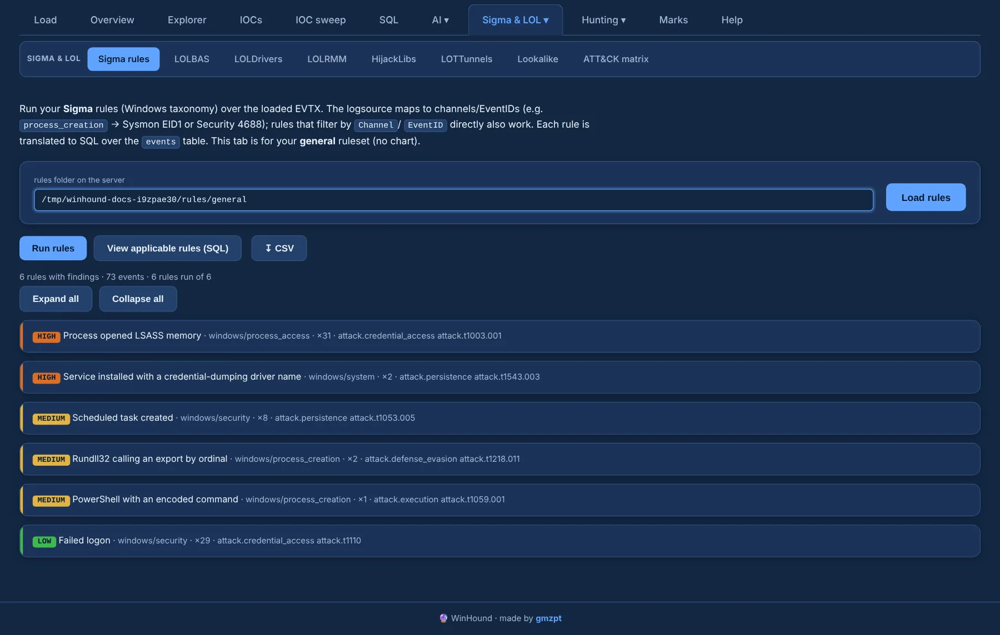

# Sigma

The **Sigma** tab (under **Sigma & LOL ▾**) runs **your** Sigma ruleset over the case. WinHound
ships no rules: point it at a folder of `.yml` files on the server, press **Load rules** (with a
progress bar, file by file) and **Run rules** (with per-rule progress).

{ .shot }

## How rules map to EVTX

The field taxonomy is Sysmon / Windows, and log sources map to channels and EventIDs:

| Log source | Events |
|---|---|
| `process_creation` | Sysmon 1 and Security 4688 (`NewProcessName` → `Image`, …) |
| `image_load` · `driver_load` | Sysmon 7 · Sysmon 6 |
| `network_connection` · `dns_query` | Sysmon 3 · Sysmon 22 |
| `registry_event` | Sysmon 12 / 13 / 14 |
| `ps_script` | PowerShell 4104 |
| `logon` | Security 4624 / 4625 |

Rules that filter directly by `Channel` and `EventID` (no category) run too. Rules without
`product: windows` still run (multi-platform); only rules for another product are skipped.
**Correlation** rules (`event_count`, `value_count`, `temporal`) are supported.

## Findings

Findings are grouped by rule, with level and ATT&CK tags. Expand a rule to see:

- the matching events, with a **what matched** column;
- the **rule content (YAML)** — `logsource`, `detection` and metadata — next to its hits;
- per hit, **⧉ copy**, **view structured raw** (the full pretty-printed event under the row) and
  the **mark** / **＋ add to review** buttons.

**View applicable rules (SQL)** shows each rule with its equivalent SQL and YAML, and **↧ CSV**
exports the findings. The matched rules also feed the [ATT&CK matrix](attack.md).
