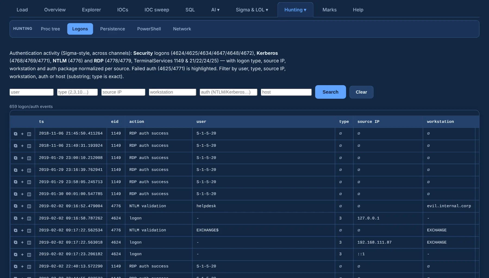

# Logons

**Logons** (under **Hunting ▾**) brings the whole **authentication family** into one table:

| Family | Events |
|---|---|
| Security logons | 4624 / 4625 / 4634 / 4647 / 4648 / 4672 |
| Kerberos | 4768 / 4769 / 4771 |
| NTLM | 4776 |
| RDP | 4778 / 4779 · TerminalServices-RemoteConnectionManager 1149 · LocalSessionManager 21 / 22 / 24 / 25 |

{ .shot }

- User, source IP, workstation and authentication package are **normalized per source**, so they
  line up across event types; failed logons are highlighted.
- **Filter boxes** narrow by **user, type, source IP, workstation, auth and host** — combine them
  to drill in, **Clear** to reset.
- Rows carry ⧉ copy and ＋ add to review.
