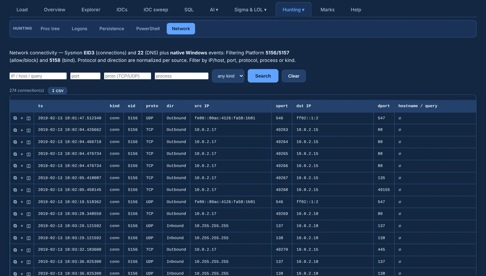

# Network

**Network** (under **Hunting ▾**) unifies connection telemetry from Sysmon and native Windows:

| Source | Events |
|---|---|
| Sysmon | 3 (network connections) · 22 (DNS queries) |
| Windows Filtering Platform | Security 5156 / 5157 (allow / block) · 5158 (bind) |

{ .shot }

- Protocol and direction are **normalized per source**, so rows from different providers compare.
- Filter by **IP / host, port, protocol, process** and **kind**.
- ⧉ copies a row's full event, ＋ adds it to review, **↧ CSV** exports the loaded rows.
