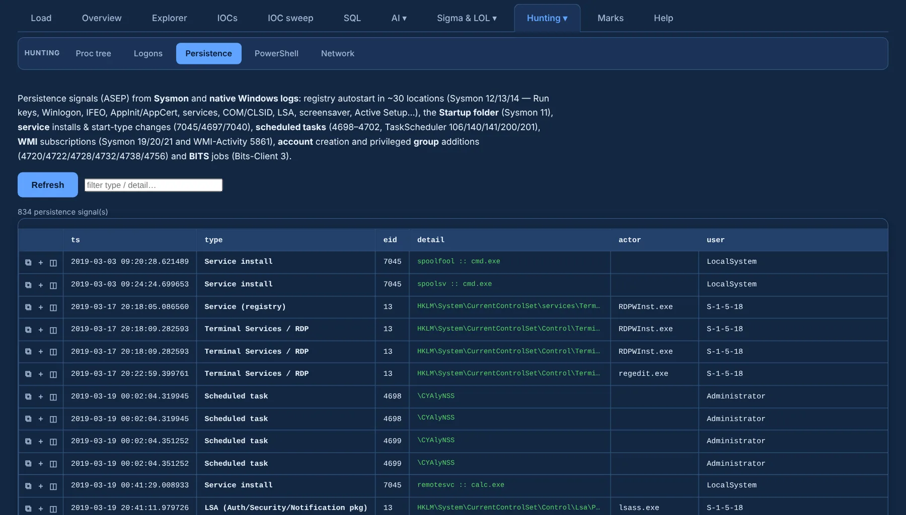

# Persistence

**Persistence** (under **Hunting ▾**) collects autostart (ASEP) activity from **Sysmon and native
Windows logs**:

| What | Events |
|---|---|
| ~65 registry autostart locations | Sysmon 12 / 13 / 14 and Security 4657 |
| Startup folder and dropped task XML | Sysmon 11 |
| Services | System 7045 · Security 4697 · start type 7040 |
| Scheduled tasks | Security 4698–4702 · TaskScheduler 106 / 140 / 141 / 200 / 201 |
| WMI subscriptions | Sysmon 19 / 20 / 21 · WMI-Activity 5859 / 5861 |
| Accounts and privileged groups | 4720 / 4722 / 4728 / 4732 / 4738 / 4756 |
| BITS jobs | Bits-Client 3 |

{ .shot }

Each row shows the type, the triggering EventID, host, actor and detail; a filter box narrows by
type or detail. Rows carry ⧉ copy and ＋ add to review.
