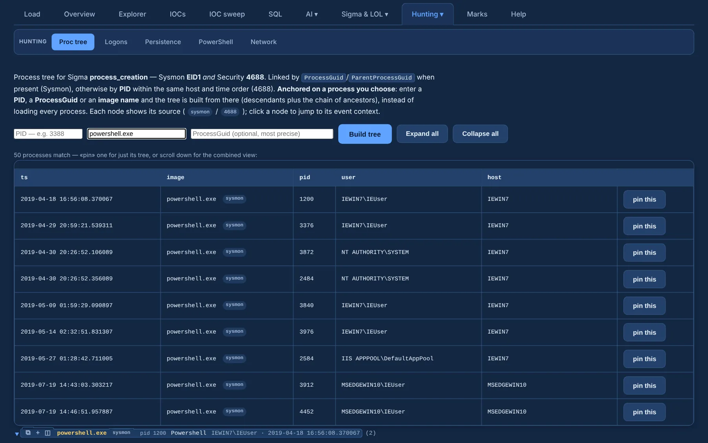

# Process tree

**Proc tree** (under **Hunting ▾**) rebuilds process trees from Sigma `process_creation`
events: **Sysmon 1** and **Security 4688**.

{ .shot }

- **Anchor it on a process**: type a **PID**, a **ProcessGuid** or an **image name** and press
  **Build tree**. You get that process's **descendants plus its chain of ancestors**, instead of
  every tree in the case.
- When a PID matches several processes (PIDs are reused), a picker lets you **pin** the exact
  one; the anchored process is highlighted.
- Processes are linked by `ProcessGuid` / `ParentProcessGuid` when present (Sysmon), otherwise by
  **PID** (`ProcessId` / `NewProcessId`, hex-normalized) on the same host, in time order.
- When Sysmon and 4688 log the same process the duplicate is merged; each node shows its
  **source** (`sysmon` / `4688`).
- **Expand all** / **Collapse all**; click a node to jump to its context.
