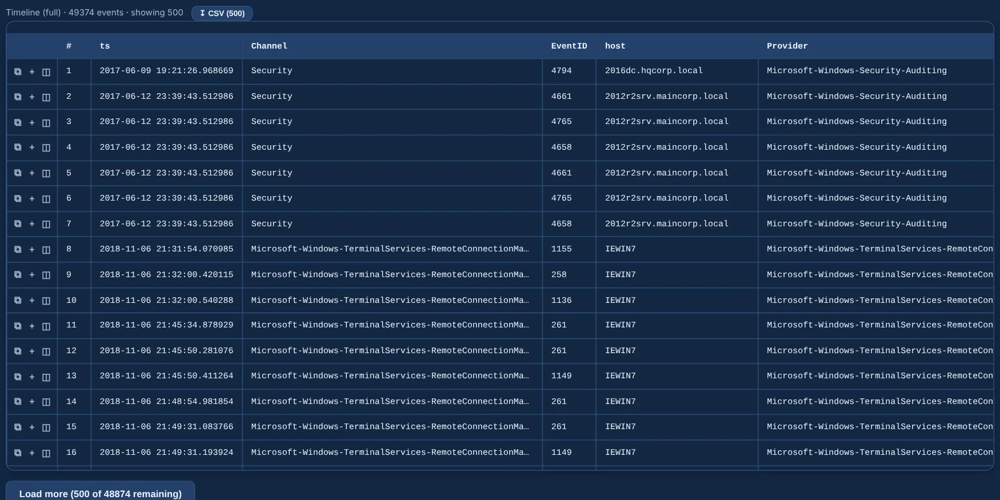

---
hide:
  - navigation
---

# WinHound

**Forensic Windows EVTX analyzer — ingest event logs, query with SQL, hunt with Sigma.**

Feed it `.evtx` files — one by one, a whole folder or straight from a `.zip` — and investigate in
the browser: one normalized timeline in UTC, full-text and field search, Sigma and
living-off-the-land detections, process trees, logons, persistence, PowerShell, network,
IOCs, triage marks and a one-click case report. **Everything runs locally and offline.**

{ .shot }

-   :material-rocket-launch-outline:{ .lg .middle } **Getting started**

    ---

    Install it, run it, load the 562 public attack samples that ship with it.

    [:octicons-arrow-right-24: Getting started](getting-started.md)

-   :material-magnify:{ .lg .middle } **Investigate**

    ---

    [Explorer and timeline](investigate/explorer.md) · [Overview and GeoIP](investigate/overview.md) ·
    [IOCs and IOC sweep](investigate/iocs.md) · [SQL](investigate/sql.md) ·
    [Marks and report](investigate/marks-report.md)

-   :material-shield-search:{ .lg .middle } **Detection**

    ---

    [Sigma](detection/sigma.md) · [LOL packs](detection/lol.md) ·
    [Lookalike binaries](detection/lookalike.md) · [ATT&CK matrix](detection/attack.md)

-   :material-target-account:{ .lg .middle } **Hunting**

    ---

    [Process tree](hunting/process-tree.md) · [Logons](hunting/logons.md) ·
    [Persistence](hunting/persistence.md) · [PowerShell](hunting/powershell.md) ·
    [Network](hunting/network.md)

-   :material-code-tags:{ .lg .middle } **One query language**

    ---

    `field=value` equal, `field:value` contains, `AND` / `OR` / `NOT`, wildcards, ranges —
    the same in Longanizer. [:octicons-arrow-right-24: Query language](reference/query-language.md)

-   :material-earth-off:{ .lg .middle } **Local and offline**

    ---

    No cloud and no outbound calls, except the optional GeoIP download and the AI endpoint
    you configure yourself.

## What every case gives you

| | |
|---|---|
| **Timeline** | every record of every channel normalized into one `events` table in UTC — System fields as columns, EventData promoted or kept in `extra`, the full record in `raw` |
| **Search** | free text and fields with one query language, facets, a cheatsheet and field autocomplete; click any cell to filter by its value |
| **Detections** | your Sigma rules and LOL packs with what matched, the rule YAML and the raw event, plus ATT&CK coverage and lookalike binaries |
| **Hunting** | process trees, the logon family (Kerberos, NTLM, RDP), about 65 persistence locations, reassembled PowerShell script blocks and network telemetry |
| **IOCs** | indicators discovered in the data, and a sweep for the ones you paste |
| **Triage and report** | pending / TP / FP / dismissed marks with notes and frozen context, and a self-contained HTML report |
| **AI and MCP** | ask about the case through your AI provider, a local model or an MCP client — read-only |

!!! info "About the screenshots"
    Every picture on this site comes from the **public sample set** that ships with WinHound
    (`samples/evtx-attack-samples.zip`, EVTX-ATTACK-SAMPLES by @sbousseaden) and a few small
    demo Sigma rules, taken by `python scripts/docs_screenshots.py`. None of them shows a real case.
