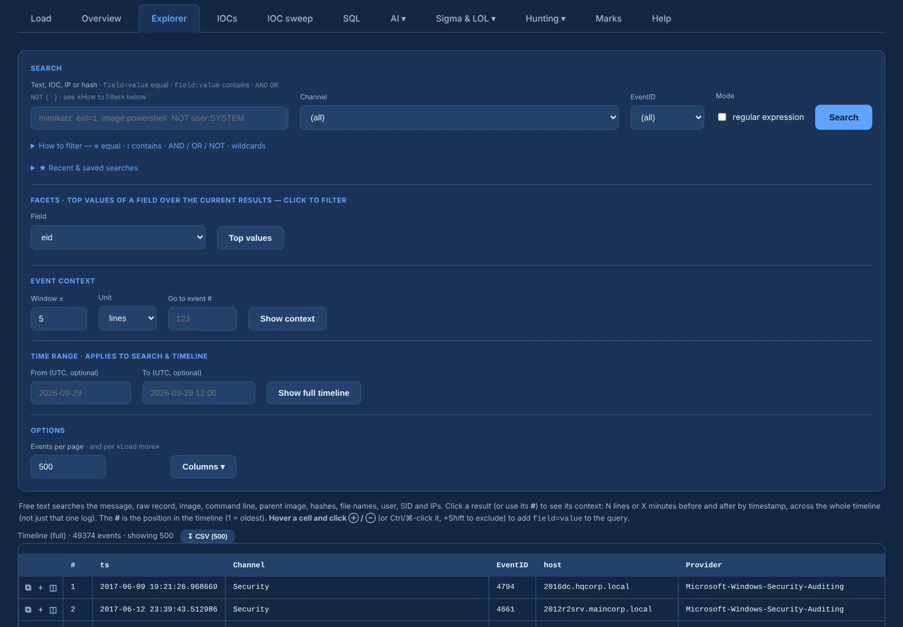
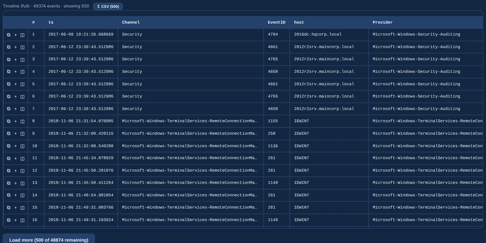
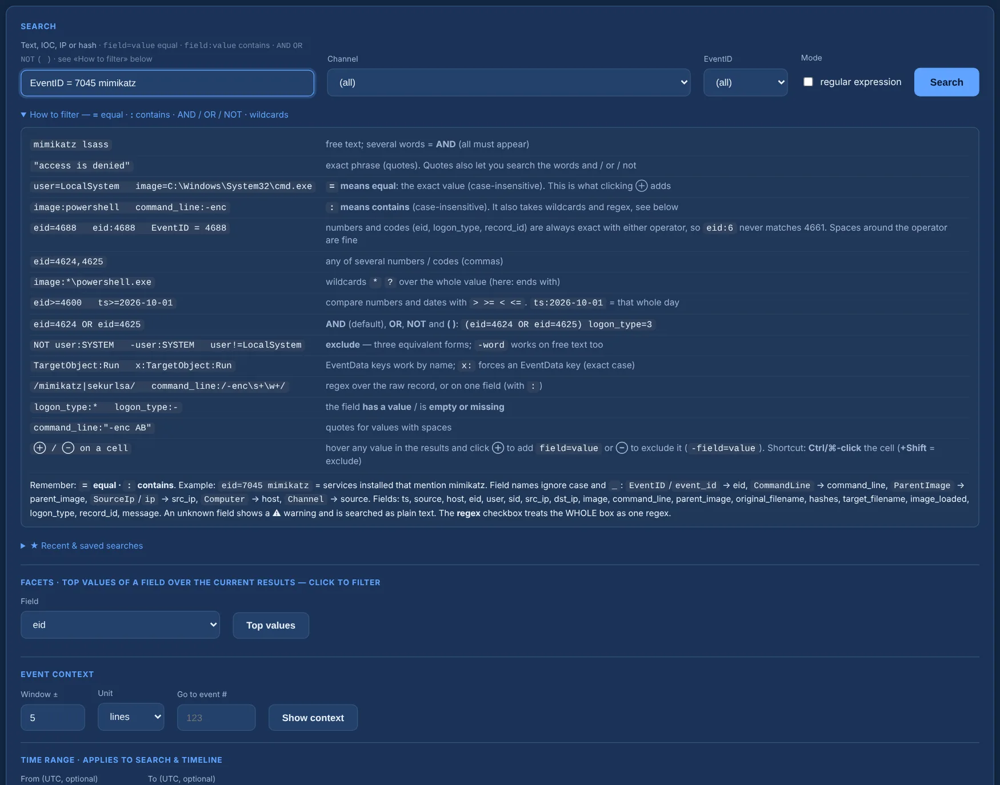
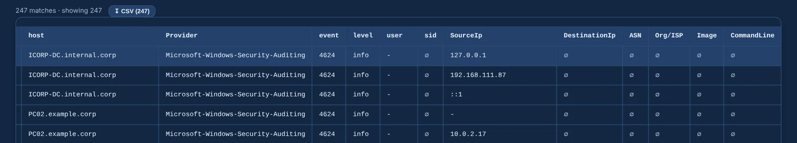
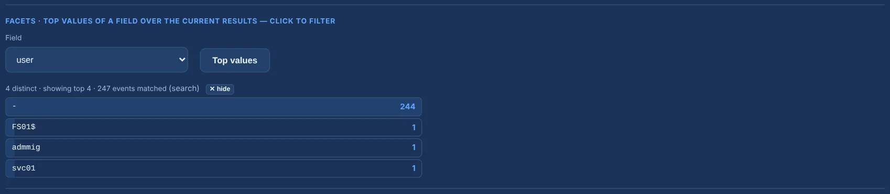
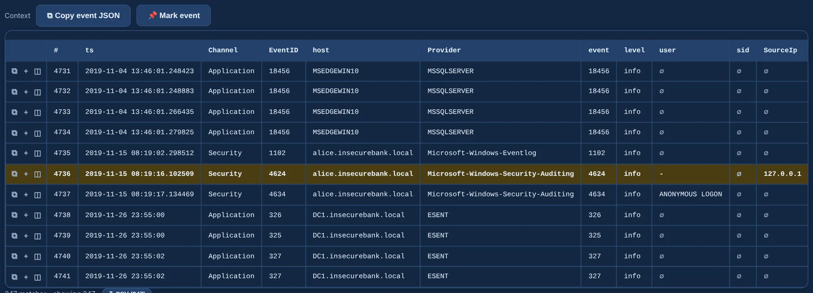
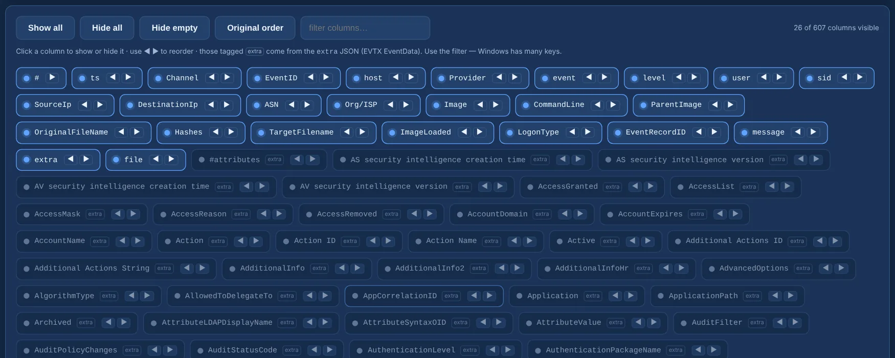

# Explorer and timeline

The Explorer is where you read the case: the **full timeline** of every channel, or the events
that match a **search**, in one table.

{ .shot }

## Timeline

**Show full timeline** lists every event in time order, 500 per page (**Load more** brings the
next page; change the page size under **Options**). Each row carries a **#** — its position in the
timeline, `#1` being the oldest.

{ .shot }

The **Channel** and **EventID** dropdowns (both `(all)` by default, filled from what is loaded) and
the **Time range** (From / To, UTC) narrow both the timeline and the search.

## Search

Type any text — an IP, a hash, a command, an image name — or use fields:

```text
EventID = 7045 mimikatz
image:powershell command_line:-enc
(eid=4624 OR eid=4625) logon_type=3 NOT user:SYSTEM
```

The essentials:

- **`field=value` means equal** (exact, case-insensitive) and **`field:value` means contains**.
  Numbers and codes such as `eid`, `logon_type` or `record_id` are exact with either one, so
  `eid:6` never matches 4661.
- Words separated by spaces are **AND**; there are **OR**, **NOT** and parentheses too.
- EventData keys work by name (`TargetObject:Run`).
- An unknown field shows a ⚠ warning instead of returning nothing in silence, and a malformed
  query says what is wrong.

The full syntax is in the [query language reference](../reference/query-language.md). Under the box,
**How to filter** opens a cheatsheet, and the box **autocompletes field names**:

{ .shot }

The **regular expression** checkbox treats the whole box as one regex instead.

**Recent & saved searches** keeps your last queries and the ones you name (stored in this browser).

## Filter from a cell

Hover any value in the results and click **⊕** to add `field=value` to the query, or **⊖** to
exclude it (`-field=value`). The search re-runs at once. Shortcut: **Ctrl/⌘-click** the cell,
with **Shift** to exclude. Values with spaces are quoted for you and empty cells become `field:-`.

{ .shot }

## Facets

Pick a field and click **Top values** to see its most frequent values over the current view —
the whole timeline or the current search. Click one to add it to the query. Categorical fields
(`eid`, `user`, `image`, `src_ip`, `asn`, `org`…) are the useful ones.

{ .shot }

## Context

Click a row to see the events around it on the whole timeline: **± N lines** or **± N minutes**.
**Go to event #** jumps to a position directly.

{ .shot }

Every row has three buttons:

- **⧉** copies the **full event JSON** — not just the truncated cells;
- **＋** adds the event to your [marks](marks-report.md) as *pending*;
- **◫** opens the **structured event** to read and copy the whole record.

The context header also has **Copy event JSON** and **Mark event**.

## Columns

**Columns** opens a panel with every first-class column plus **every EventData key** found in the
case (they start hidden — Windows has hundreds). Use its filter box, click to show or hide,
reorder with ◀ ▶, and sort by clicking a header (the server sorts the whole set). **EventID** and
**Channel** are visible by default.

{ .shot }

Two GeoIP columns, **ASN** and **Org/ISP**, are filled from the row's source IP (else the
destination IP) once the ASN database is downloaded (see [Overview](overview.md)). They only
fill for public IPs.

Only visible columns are rendered and long cells are truncated (the full value is on hover), so
the table stays fast with hundreds of thousands of events. **↧ CSV** exports the loaded rows.
