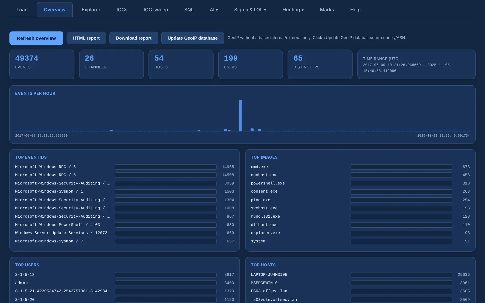

# Overview and GeoIP

The **Overview** is the case at a glance: event, channel, host, user and IP counts, the time range,
events per hour, and the top EventIDs, images, hosts, users, logon types and channels. Click a row
to open the Explorer already filtered on it.

{ .shot }

## GeoIP

Source and destination IPs are always tagged **internal** (RFC 1918, loopback, link-local) or
**external** — no database needed.

**Update GeoIP database** downloads the free **DB-IP Lite** databases once; from then on, offline,
public IPs also get their **country, ASN and ISP**, and the Overview adds Top ISP and Top countries.
On start, WinHound refreshes them in the background **only if they are missing or older than 30
days**, and stays silent without network.

Click any IP for its detail: first and last seen, channels, users and sample events.

The same ASN · Org/ISP tags appear in the Explorer columns, the IOC extractor and the IOC sweep.

## Report

**HTML report** opens the case report in a new tab and **Download report** saves it — see
[Marks and report](marks-report.md#report).
