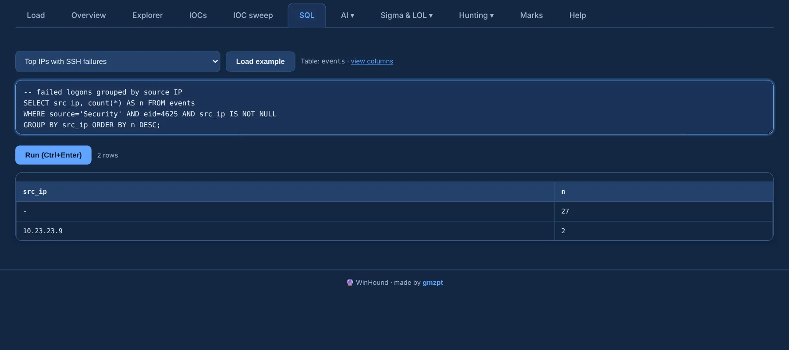

# SQL

The **SQL** tab runs read-only DuckDB SQL over the `events` table. Pick a ready-made query from the
dropdown and **Load example**, or write your own; **Run** (or Ctrl+Enter) executes it.

{ .shot }

- Only reads are allowed (`SELECT`, `WITH`, `DESCRIBE`, `SUMMARIZE`, `SHOW`, `PRAGMA`); the case
  can't be changed from here. Comments at the start (`-- …`) are fine.
- EventData values live in the `extra` JSON column: `extra->>'TargetObject'`. Wrap it in
  parentheses inside expressions — `(extra->>'TargetObject') ILIKE '%\Run\%'` — or use
  `json_extract_string(extra, '$.TargetObject')`.
- **view columns** lists every column; the [data model](../reference/data-model.md) explains them.

More examples in [SQL recipes](../reference/sql-recipes.md).
